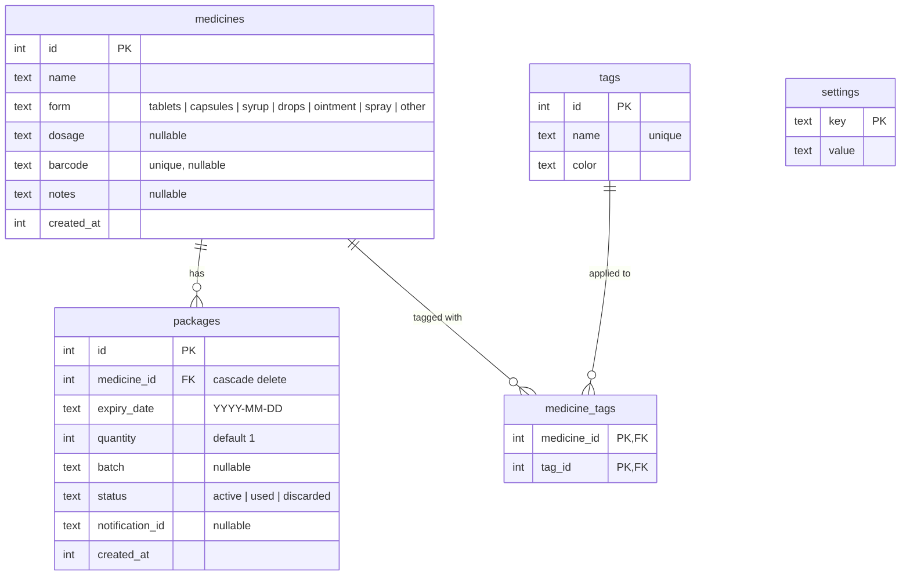

<div align="center">

# 💊 MedKit

**Keep track of the medicines in your home first-aid kit and never take an expired pill again.**

An offline-first mobile app built with Expo and React Native. Add medicines, record the
expiry date of every package, and see at a glance what is about to expire.

[](https://docs.expo.dev/versions/v58.0.0/)
[](https://reactnative.dev)
[](https://www.typescriptlang.org)
[](#getting-started)
[](#roadmap)

[Features](#features) · [Getting started](#getting-started) · [Architecture](#architecture) ·
[Data model](#data-model) · [Roadmap](#roadmap) · [Contributing](#contributing)

</div>

---

## Features

- **Medicine list** with search by name, multi-select tag filters and colour-coded expiry
  status: 🟢 more than 30 days, 🟡 30 days or less, 🔴 expired. Sorted by the nearest expiry date.
- **Multiple packages per medicine**, each with its own expiry date and quantity. Mark a package
  as _used up_ or _discarded_, restore it from the archive, or change its date in place.
- **Smart expiry input**: a native date picker, plus a "month and year only" option that stores
  the last day of the month, the way dates are printed on most packaging.
- **Tags** (pain, fever, allergy, …) to group medicines, created on first launch in the device
  language.
- **Fully offline**: no account, no backend; all data lives in a local SQLite database on the
  device.
- **Bilingual UI** (Ukrainian and English) that follows the device language, with correct
  plural forms and localized dates.
- **Light and dark theme** that follows the system setting, with native tab bar and iOS large
  titles.

Local expiry reminders, a barcode / GS1 DataMatrix scanner and onboarding are on the
[roadmap](#roadmap).

## Tech stack

| Area               | Choice                                                                                                                                                                      |
| ------------------ | --------------------------------------------------------------------------------------------------------------------------------------------------------------------------- |
| Framework          | [Expo SDK 58](https://docs.expo.dev) · React Native 0.88 · React 19 (React Compiler enabled)                                                                                |
| Navigation         | [Expo Router](https://docs.expo.dev/router/introduction/) with native tabs and a stack per tab                                                                              |
| Database           | [expo-sqlite](https://docs.expo.dev/versions/latest/sdk/sqlite/) + [Drizzle ORM](https://orm.drizzle.team) (migrations via `drizzle-kit`)                                   |
| Reactive data      | Drizzle `useLiveQuery`; no global state library                                                                                                                             |
| Forms              | [react-hook-form](https://react-hook-form.com) + [zod](https://zod.dev)                                                                                                     |
| Styling            | [NativeWind](https://www.nativewind.dev) (Tailwind CSS) with semantic colour tokens for light/dark                                                                          |
| i18n               | [i18next](https://www.i18next.com) + react-i18next + expo-localization, type-checked translation keys                                                                       |
| Dates              | [date-fns](https://date-fns.org)                                                                                                                                            |
| UI building blocks | [@expo/ui](https://docs.expo.dev/versions/latest/sdk/ui/) date picker, [react-native-keyboard-controller](https://kirillzyusko.github.io/react-native-keyboard-controller/) |
| Tooling            | TypeScript (strict), ESLint, Prettier (+ Tailwind class sorting)                                                                                                            |

## Getting started

MedKit uses native modules, so it runs in a
[development build](https://docs.expo.dev/develop/development-builds/introduction/), not in
Expo Go.

### Prerequisites

- **Node.js** 22.13+ or 24.3+ (as required by Expo SDK 58)
- **Android**: [Android Studio](https://developer.android.com/studio) with an emulator or a device
  with USB debugging, and JDK 17
- **iOS** (macOS only): Xcode with an iOS Simulator

### Install and run

```bash
git clone https://github.com/OleksandrKravchuk1/MedKit.git
cd MedKit
npm install

# Build the development client, install it and start Metro
npm run android   # or: npm run ios
```

The first build takes a few minutes. Afterwards you only need to start the bundler and open the
already installed app:

```bash
npm start
```

Rebuild with `npm run android` / `npm run ios` only after adding a native dependency or
changing a config plugin in `app.json`.

> [!NOTE]
> The `android/` and `ios/` directories are generated by
> [Continuous Native Generation](https://docs.expo.dev/workflow/continuous-native-generation/)
> and are git-ignored. Configure native behaviour in `app.json` and config plugins instead of
> editing them.

### Scripts

| Command                | Description                                           |
| ---------------------- | ----------------------------------------------------- |
| `npm start`            | Start the Metro bundler for the installed dev build   |
| `npm run android`      | Build and run the development build on Android        |
| `npm run ios`          | Build and run the development build on iOS            |
| `npm run typecheck`    | Type-check the project with `tsc`                     |
| `npm run lint`         | Lint with ESLint (Expo config)                        |
| `npm run format`       | Format all files with Prettier                        |
| `npm run format:check` | Check formatting (use in CI)                          |
| `npm run db:generate`  | Generate a SQL migration after changing the DB schema |

## Architecture

### Project structure

```
src/
├── app/                  # Screens only (Expo Router file-based routes)
│   ├── (tabs)/           # Native tabs, each with its own Stack
│   │   ├── (medicines)/  #   Medicines list
│   │   └── settings/     #   Settings
│   └── medicine/         # New, details, edit
├── features/             # Feature modules (see below)
│   ├── medicines/
│   └── tags/
├── components/           # Shared UI
│   ├── ui/               #   Button, Chip, Fab
│   ├── form/             #   Text, date and stepper fields, keyboard-aware scroll view
│   └── feedback/         #   Empty / error / loading states
├── db/                   # Drizzle schema, client, seed, migration runner hook
├── i18n/                 # i18next setup, locales, date and plural formatting
├── lib/                  # Framework-free helpers (dates, class names, alerts)
├── constants/            # Domain values and theme colours
└── hooks/                # Shared hooks
drizzle/                  # Generated SQL migrations
docs/SPEC.md              # Product specification
```

### Feature modules

Each feature groups its files by role, so it is always clear where code belongs:

```
features/medicines/
├── components/   # React components, one per file
├── hooks/        # Live read hooks (useLiveQuery)
├── mutations/    # Database writes, one file per entity
├── schemas/      # zod form schemas
├── constants/    # Form limits and defaults, status colour classes
├── utils/        # Pure logic without React or the database (unit-testable)
└── types/        # Feature types
```

### Principles

- **Layered dependencies**: `app → features → components / lib / db / constants`. Lower layers
  never import from features, and the database layer does not depend on i18n.
- **Screens contain no queries.** Database access lives in feature hooks and mutations.
- **Pure logic is isolated** in `utils/` and `lib/`, so it can be tested without a device or a
  database.
- **No barrel files.** Imports point at concrete modules: Metro does not tree-shake, and barrels
  make import cycles more likely.
- **No hard-coded UI strings.** Every user-facing text goes through `t()`; translation keys are
  type-checked against `uk.json`, and a missing key in `en.json` fails the type check.
- **Semantic colours only** (`bg-card`, `text-foreground`, `text-muted`, …), defined as CSS
  variables with light and dark values.

### Live data

`useLiveQuery` re-runs a query only when the table in its `FROM` clause changes; joined tables
are not tracked. Hooks therefore run one live query per table and combine the rows in a pure
function (for example `buildMedicineList`), which keeps every view up to date after any write.

## Data model



A medicine can have several packages with different expiry dates; reminders are attached to
packages. Deleting a medicine removes its packages and tag links through `ON DELETE CASCADE`.

### Changing the schema

1. Edit [`src/db/schema.ts`](src/db/schema.ts).
2. Run `npm run db:generate` to create a migration in [`drizzle/`](drizzle/).
3. Restart the app: pending migrations are applied on launch, before the first screen renders.

## Localization

Translations live in [`src/i18n/locales`](src/i18n/locales). `uk.json` is the source of truth
for keys; `en.json` must contain the same keys, which the type check enforces.

- Use `useTranslation()` in components and `i18n.t()` elsewhere.
- Format dates and "N days left" only through [`src/i18n/format.ts`](src/i18n/format.ts).
  Plural forms are computed by `pluralCategory` rather than `Intl.PluralRules`, whose support
  differs between JavaScript engines, so interpolate counts as `{{n}}`, not `{{count}}`.
- Validation messages in zod schemas are translation keys (`msg("validation.…")`), translated
  when they are displayed.

## Roadmap

- [x] **Stage 1**: SQLite + Drizzle setup, schema, migrations, first-launch seed
- [x] **Stage 2**: Medicines list, create/edit form and details with full CRUD
- [x] Light/dark theme, Ukrainian and English UI, keyboard-aware forms
- [ ] **Stage 3**: Local expiry notifications, settings (reminder days, time, tags), onboarding
- [ ] **Stage 4**: Barcode and GS1 DataMatrix scanner with unit-tested parser
- [ ] **Stage 5**: Polish, error handling, release builds with EAS
- [ ] In-app language switch

See [`docs/SPEC.md`](docs/SPEC.md) for the full product specification.

## Contributing

1. Create a branch from `master`.
2. Follow the conventions above: feature modules, semantic colours, translated strings,
   kebab-case file names and named exports.
3. Install native packages with `npx expo install <package>` so versions match the Expo SDK.
4. Before opening a pull request, make sure all checks pass:

   ```bash
   npm run typecheck && npm run lint && npm run format:check
   ```

## License

See [LICENSE](LICENSE).
